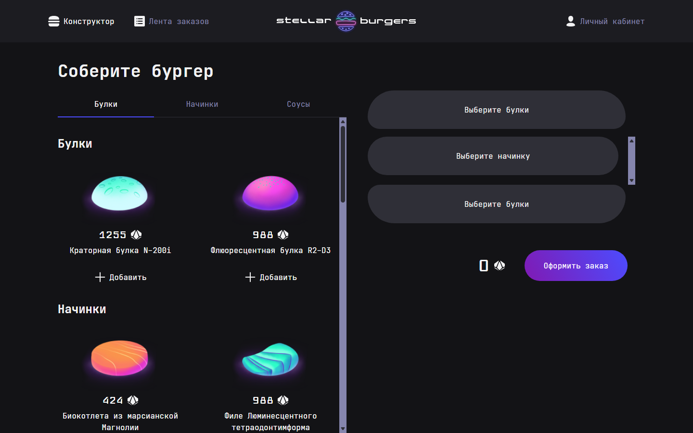

# 🍔 Stellar Burgers

Одностраничное приложение космической бургерной: пользователь собирает бургер из ингредиентов, оформляет заказ и следит за ним в ленте и в личном кабинете.

**🔗 Демо:** [wthreeee.github.io/stellar-burgers](https://wthreeee.github.io/stellar-burgers/)



## Возможности

- **Конструктор бургера** — выбор булки и начинок по категориям, перестановка начинок, подсчёт итоговой цены
- **Оформление заказа** — отправка на сервер и получение номера заказа
- **Лента заказов** — все заказы сервиса со статусами и статистикой за день
- **Регистрация и авторизация** — вход, регистрация, восстановление и сброс пароля
- **Личный кабинет** — редактирование профиля и история своих заказов
- **Защищённые маршруты** — страницы профиля доступны только авторизованным, страницы входа — только гостям
- **Модальные окна с собственным URL** — детали ингредиента или заказа открываются поверх страницы, а по прямой ссылке — отдельной страницей
- **Автообновление токена** — при истёкшем access-токене запрос повторяется после обновления через refresh-токен

## Стек

| | |
|---|---|
| Язык | TypeScript |
| UI | React 18, CSS Modules |
| Состояние | Redux Toolkit (`createSlice`, `createAsyncThunk`) |
| Роутинг | React Router 6 |
| Сборка | Webpack 5, Babel |
| Качество кода | ESLint, Prettier |
| UI-компоненты | Storybook |

## Структура

```
src/
├── components/   # переиспользуемые компоненты (конструктор, модалки, карточки заказов)
│   └── ui/       # презентационные компоненты без логики
├── pages/        # страницы приложения
├── services/
│   ├── slices/   # Redux-слайсы: auth, constructor, ingredients, orders, feeds, profile
│   └── store.ts
└── utils/        # API-клиент, работа с cookie, типы
```

## Запуск локально

```bash
git clone https://github.com/wthreeee/stellar-burgers.git
cd stellar-burgers
npm install
cp .env.example .env
npm start
```

Приложение откроется на `http://localhost:4000`.

| Команда | Что делает |
|---|---|
| `npm start` | dev-сервер с hot reload |
| `npm run build` | продакшен-сборка в `dist/` |
| `npm run storybook` | Storybook с UI-компонентами |
| `npm run lint` | проверка ESLint |

---

Учебный проект курса «Фронтенд-разработчик» Яндекс Практикума. Макет и API предоставлены курсом, логика приложения, роутинг, работа с состоянием и авторизация реализованы самостоятельно.
